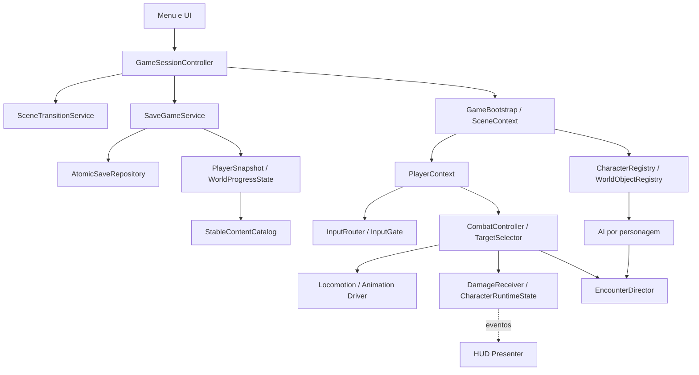

# Karawara — TO-BE arquitetural

**Estado:** proposta para revisão, sem implementação autorizada neste pacote.
**Data:** 01/10/2026, America/Sao_Paulo.
**Base:** commit `a2b43f09`; Unity `6000.4.6f1`; URP `17.4.0`; Input System `1.19.0`; Netcode atual `2.11.1`.
**Método:** Superpowers brainstorming para desenho e writing-plans para decomposição. Os planos são rascunhos completos de implementação; sua existência não representa aprovação para executá-los.

## 1. Intenção e limites

O usuário pediu um TO-BE e planos para: tornar o jogo totalmente local, implementar Freeflow Combat, otimizar rendering e código, reorganizar arquitetura/pastas e estabilizar o save. A ordem segue a análise anterior: proteger saves e medir; migrar para local; consolidar arquitetura e persistência; implementar Freeflow; otimizar e validar o resultado integrado.

O produto desejado é um RPG single-player com o conteúdo atual preservado, combate fluido entre múltiplos alvos e persistência confiável. A migração deve preservar lança, caster, magias, skills, interação, tutorial, missões, bosses, checkpoints, HUD e transições existentes. Mudanças de sensação de combate pertencem à fase Freeflow.

Decisão do usuário nesta elaboração: **Freeflow mais simples, sem counter**. O desenho inclui seleção direcional de inimigos, aproximação assistida e combos entre alvos, preservando esquiva, lança, magias e habilidades atuais. Valores de tuning abaixo são defaults iniciais propostos, não medições nem balanceamento aprovado.

Não fazem parte da entrega: multiplayer futuro, novo conteúdo narrativo, compras de animações, troca de engine, serviços cloud, ECS/DOTS, container de DI ou mudança da versão Unity. Animações ausentes devem ser identificadas como dependência de conteúdo antes do acabamento; não aprovar o Freeflow com placeholders visualmente inadequados.

## 2. AS-IS e força das evidências

| Evidência atual | Implicação para o plano |
|---|---|
| `Assets/Scripts/TitleScreenManager.cs` e `LocalHostStartup.cs` abrem host local | Jogar sozinho ainda depende de rede |
| `CharacterNetworkManager`, `PlayerNetworkManager`, colliders, IA e spawners usam Netcode | Migração inclui estado, notificações e ciclo de vida, além do pacote |
| `PlayerManager.OnNetworkSpawn` conecta HUD/estado; load é condicionado a `IsOwner && !IsServer` | Caracterizar e corrigir restauração no host antes de removê-lo |
| `SaveFileDataWriter` escreve no destino com `FileMode.Create` | Falha de escrita pode perder a última cópia válida |
| `UI_Character_Save_Slot` carrega ao habilitar slot 01; skills restauram slot 01 | Leitura do menu deve ser separada do comando de carregar |
| `CharacterSaveData` contém `Skill[]`; `WorldItemDatabase.Awake` atribui `itemID` pelo índice | DTOs e IDs persistentes precisam ser independentes de objetos Unity e ordem de listas |
| Input, UI, save, carregamento e skills têm dependências cruzadas | Extrair responsabilidades em etapas, preservando referências serializadas |
| High Fidelity: MSAA4, sombras4096, distância150, depth/opaque, SSAO e passe de tela | Candidatos a A/B, não diagnóstico de configuração incorreta |
| OverlapSphere recorrente e materiais sem descarte explícito em algumas classes | Alocação concreta e suspeita de retenção; crescimento de memória exige snapshots |
| Relatórios `Docs/Homol*` registram build e fixtures; `ProfilerCaptures` está vazio | Histórico útil de regressão; sem benchmark atual nem prova de round-trip de saves |

As referências acima foram relidas nesta elaboração. Não foram executados novos testes do jogo. Os relatórios existentes não validam alterações futuras, percurso integral, persistência em processo novo ou ganho de desempenho.

## 3. Abordagens consideradas

| Abordagem | Benefício | Custo/risco | Decisão |
|---|---|---|---|
| Migração incremental por responsabilidade | Cada etapa tem comportamento comparável e rollback | Adapters temporários precisam ter data de remoção | Recomendada |
| Reescrita integral de player/IA/UI/save | Liberdade arquitetural | Grande perda de evidência e regressões simultâneas | Não escolhida |
| Manter host invisível e organizar arquivos | Menor esforço inicial | Não atende execução totalmente local; mantém acoplamento | Não escolhida |

Adapters de compatibilidade são transitórios. Ao fechar a fase local, nenhuma implementação de produção ou DevPlayground depende de host, ownership, RPC ou NetworkVariable. Na fase arquitetural, retirar wrappers sem consumidores. Não adicionar abstrações sem uma dependência real que justifique a fronteira.

## 4. Restrições globais

- Unity permanece em `6000.4.6f1`; URP permanece em `17.4.0` durante estas fases.
- Plataforma de aceite: Windows x64 standalone; Editor e fixtures são evidências complementares.
- Preservar GUIDs/metas e referências de cenas, prefabs, UnityEvents e animation events em migrações.
- Preservar saves reais. Testes usam diretório temporário injetado; restauração manual usa cópias e um diretório de QA separado.
- Não editar código de terceiros ou gerado: `PlayerControls.cs`, xNode, DOTween, PathCreator e plugins ficam fora das refatorações próprias.
- Sem novo framework de DI, event bus global ou persistência cloud. Usar composição explícita e eventos tipados no dono do estado.
- Nenhum ganho de performance é aceito só por reduzir draw calls; comparar frame time, memória e aparência nas mesmas condições.
- Compilação, teste automatizado, gameplay e desempenho são gates distintos; relatório deve dizer quais foram executados.
- Não fazer commit/push/merge automático durante a execução futura sem respeitar as instruções da sessão e a baseline de alterações locais.

## 5. Arquitetura TO-BE



### 5.1 Bootstrap, sessão e cenas

`GameBootstrap` compõe serviços de aplicação uma vez; `SceneContext` registra dependências e objetos da cena. `GameSessionController` coordena NewGame, LoadGame, ReturnToMenu e encerramento. Player é persistente somente durante uma sessão ativa; inimigos, spawners e contexto pertencem à cena. Retornar ao menu encerra a sessão e limpa referências.

Fluxo de load: ler e validar save → preparar estado em memória → carregar cena → registrar contexto → criar/bindar player → aplicar estado uma vez → atualizar HUD → habilitar input. Repetir comando enquanto transição está ativa retorna Busy. Falha de leitura não inicia troca de cena. Falha após trocar cena termina numa tela recuperável, com input bloqueado e opção de retornar ao menu; não sobrescreve o save.

`SceneTransitionService` usa tempo não escalado. Pausa/tutorial não podem prender o loading. Acesso direto a cenas de desenvolvimento usa sessão temporária de QA, sem writes reais.

### 5.2 Estado de personagem e gameplay local

`CharacterRuntimeState` armazena vida, atributos, flags e alvo local; eventos tipados notificam somente mudanças. A tabela de migração deve classificar cada NetworkVariable como estado de gameplay, apresentação ou sincronização descartável. Variáveis exclusivamente de sincronização não precisam ser recriadas.

Locomoção, combate, inventário, efeitos e animação mantêm componentes focados. O contexto do player resolve referências uma vez, em vez de procurar singletons durante ações. HUD consome eventos; não escreve HP. Dano usa referência local ao receptor e identidade por personagem/ação, sem NetworkObjectId.

`CharacterRegistry` fornece consulta aos personagens ativos e remove entradas em disable, morte definitiva e unload. Clones de estados/ações mutáveis pertencem ao personagem e são descartados; dados de definição em ScriptableObjects permanecem compartilhados e imutáveis em runtime.

### 5.3 Input, pausa e apresentação

`InputRouter` é o consumidor de Input System. Produz comandos para player e UI; skills deixam de consultar Keyboard diretamente. `InputGate` emite tokens por bloqueio: pausa, diálogo, cutscene, loading e morte. Liberar um token não libera o input se outro bloqueio ainda existir. Pausa congela o tempo de gameplay; loading e apresentação que precisam avançar usam unscaled time.

Animation events permanecem em um bridge com métodos compatíveis enquanto controllers/clips são migrados. Eventos atrasados de uma ação cancelada não podem reabrir hitboxes. UI recebe presenters por tela: HUD, pause/skills e save slots.

### 5.4 Estrutura de pastas e assemblies

```text
Assets/Karawara/Runtime/
  Core/             # contratos e modelos puros; assembly independente
  Session/          # bootstrap e orquestração Unity de sessão/cena
  Input/            # router Unity e integração de pausa/input
  Characters/       # estado, player, locomoção, animação, stats e inventário
  Combat/           # ações, dano, targeting e encounter director
  AI/               # FSM, percepção e comportamentos de inimigos/bosses
  Progression/      # skills, checkpoints, bosses, missões e mundo
  Persistence/      # DTOs, repositório, migrações e captura/aplicação
  UI/               # presenters e telas
  Rendering/        # código próprio de render features e materiais
Assets/Karawara/Editor/
Assets/Karawara/Generated/Input/ # wrapper Input System intacto, assembly próprio
Assets/Tests/EditMode/
Assets/Tests/PlayMode/
Assets/DevTools/     # preservar ferramentas e cenas QA existentes
```

Primeiro extrair responsabilidades nos caminhos existentes. Mover código próprio com `.meta` preservado em lotes verificáveis; atualizar namespaces só em tarefa dedicada. Modelos, materiais, animações e conteúdo de terceiros não serão movidos em massa. Serviços Unity que conhecem player/UI vivem em Session/Input no assembly Gameplay, fora da subárvore Core.

Para testes iniciais, extrair contratos puros para `Assets/Karawara/Runtime/Core/Karawara.Core.asmdef`; Assembly-CSharp pode referenciá-los. Criar `Karawara.Core.EditModeTests.asmdef` para testes desses contratos. Fixtures dos componentes legados ficam em `Assets/DevTools/Editor` enquanto não podem ser referenciados por assembly de teste. Depois que os scripts próprios forem movidos, criar `Karawara.Gameplay.asmdef` referenciando Core e assemblies de pacotes efetivamente usados; Core nunca referencia Gameplay. Wrapper PlayerControls e inputactions podem ser movidos juntos, intactos e com metas preservados, para Generated/Input com asmdef próprio `Karawara.Input.Generated` referenciando Unity.InputSystem; Gameplay referencia esse assembly, não Assembly-CSharp. Isso organiza a compilação sem refatorar código gerado. Testes EditMode que precisem serializer/repository Unity ficam em `Assets/Tests/EditMode/Gameplay` com asmdef próprio referenciando Gameplay/Core. UI/Persistence permanecem na Gameplay inicialmente, com fronteiras por namespace; só dividir assembly se houver benefício demonstrado. Não criar um asmdef novo que tente referenciar Assembly-CSharp.

### 5.5 Persistência

Dois marcos: primeiro corrigir escrita/slots/host mantendo o DTO legado; depois introduzir `SaveGameDataV1` e converter saves existentes sem sobrescrever o original antes de validar a conversão.

Contrato do V1: `schemaVersion=1`, `slotId` em 1..3, `savedAtUtc` em ISO8601, `sceneId` estável, posição/rotação, nome, HP/atributos, tempo jogado, inventário/armas/spell equipados, skills desbloqueadas e três slots de skill, checkpoints, bosses despertos/derrotados, missões concluídas/objetivos e objetos persistentes. Apenas DTOs de números, strings, bools, enums e listas; nenhum UnityEngine.Object. Stamina só é persistida se o sistema atual a consumir; não ativar uma mecânica hoje comentada por causa do save. Não persistir VFX, hitboxes, ações transitórias, cooldown em andamento ou referências a NPC/Transform.

ID persistente é string serializada em cada definição/objeto, gerada uma vez no Editor e validada contra duplicatas. Guardar mapeamento legado de IDs numéricos de itens e índices de cena capturado antes de reordenar listas/build settings. IDs atuais de bosses/checkpoints são mapeados para strings com catálogo explícito. Não gerar IDs no Awake.

Skills legadas podem conter referências que não se resolvem num processo novo. O migrador só converte relações demonstráveis por catálogo/cópias conhecidas; referência ambígua preserva o original e retorna MigrationRequired com diagnóstico, sem inventar desbloqueios ou regravar dados incompletos.

Escrita: serializar e validar → escrever `.tmp` no mesmo diretório → flush → validar leitura temporária → substituir destino preservando `.bak`. No Windows, usar File.Replace para arquivo existente; primeiro save usa move no mesmo volume. Se substituição segura não puder acontecer, retornar erro e conservar arquivo anterior; não fallback para truncar. Serializar operações por slot. Loader tenta destino válido, depois backup válido; `.tmp` não é promovido automaticamente. Versionamento futuro desconhecido é erro recuperável, sem downgrade destrutivo.

Menu lista `Empty`, `Valid`, `Recoverable` ou `Invalid`; exibição não carrega gameplay. Criar/sobrescrever/excluir atualiza perfis após sucesso. Overwrite/delete continuam ligados à confirmação já existente da UI. Save falho mantém estado jogável e mostra erro; NewGame cuja gravação inicial falha permanece no menu. Snapshot/apply são separados da UI e do storage.

### 5.6 Freeflow

O combate atual é o ponto de partida. Introduzir seleção automática/direcional ao atacar, root motion assistido com colisão, encadeamento entre alvos e coordenação de encontros. Preservar lock-on manual, rolagem, lança, caster e skills, sem introduzir counter/parry ou novo binding. Usar os comandos de ataque existentes; direção de movimento orienta a seleção do próximo alvo.

Configuração inicial proposta: raio de seleção 8 m, cone direcional 120°, máximo de aproximação assistida 4 m, buffer 0,20 s, um atacante melee simultâneo por encounter. Movimento, recuperação, alcance e dano específicos continuam definidos pela arma/animação. Valores ficam em `FreeflowTuning.asset`, nunca espalhados no código.

Selector elimina mortos/desabilitados, aliados, alvos obstruídos e fora de raio; pontua direção solicitada, distância e continuidade; empate por ID de registro determinístico. Sem input direcional usa direção da câmera; sem alvo válido executa ataque atual sem deslocamento extra. Aproximação usa CharacterController e valida percurso com capsule cast, interrompendo em bloqueio; não teleporta nem atravessa paredes. Root motion e assistência passam por um único dono da movimentação para não somarem dois deslocamentos.

Estados: Idle → Approach → Windup → Active → Recovery; Dodge, Stagger e Dead têm regras explícitas de prioridade. Cancelamento por esquiva permitido em Windup e Recovery; Active só pode ser interrompido por morte/stagger. Uma ação tem ID; hitbox só aceita eventos do ID ativo e causa dano uma vez por vítima por ativação. Sair da ação sempre fecha colliders e libera reservas.

`EncounterDirector` reserva turnos de melee; libera em fim, cancelamento, morte e unload. Ranged e bosses preservam os ataques e avisos atuais, avaliando pressão no QA. A defesa continua sendo esquiva/rolagem e habilidades existentes. Não introduzir janelas de counter, parry, sistema de telegraph novo ou rework de ataques da Cuca/Saci.

Entrega em dois marcos: arena com 3 inimigos melee para seleção/approach/combos; depois integração com famílias de inimigos, ranged, bosses, magias e câmera. Arena aprovada não encerra a fase completa. Counter/parry e finisher cinematográfico estão fora deste TO-BE.

### 5.7 Desempenho, rendering e memória

Baseline por hardware-alvo documentado, build, qualidade, resolução, VSync/cap, rota, quantidade de inimigos e câmera. Se hardware-alvo não estiver disponível, relatório limita a conclusão à máquina medida. Default de QA proposto é 1920x1080, render scale 1.0 e High Fidelity atual; manter settings idênticos no A/B.

Rotas: início/exploração de Tutorial_Final e MapaEsboco, combate em `t`, arena CucaLoad, menu/skills/minimapa e nova arena Freeflow. Usar 30 s de warm-up e 120 s de captura, 3 execuções por candidato/base. Registrar mediana e p95 frame time, CPU/GPU, batches/draw calls/SetPass, triângulos, GC bytes/frame e contagem de GC, memória managed/native/texturas e contagem de materiais/objetos. Development é para atribuição; Release é para confirmar timing sem instrumentação pesada.

Teste de retenção: aquecer; capturar snapshot inicial; executar 10 ciclos menu→mundo→menu e 10 ciclos criar/destruir pet/projétil/boss; estabilizar; capturar snapshot final. Investigar objetos/recursos que continuam acumulando; crescimento isolado por cache não é automaticamente leak. Critério: nenhum recurso owned sobrevivente sem justificativa e nenhuma tendência crescente repetível após warm-up.

Prioridade orientada pelo custo medido: passes/SSAO/sombras, câmeras/minimapa, materiais/instancing/LOD/occlusion, luzes e texturas; em código, perception buffers NonAlloc com tratamento de saturação, frequência controlada, pools onde lifetime é bem definido e descarte de materiais/clones/subscriptions. Não alterar todos os importers, activar streaming global ou reduzir resolução como atalho.

Aceite proposto por candidato de timing: redução de pelo menos 5% na métrica alvo em mediana das 3 execuções e p95 sem regressão acima de 3%, sob baseline estável. Menos de 5% pode ser aceito como correção de leak/alocação demonstrada, com benefício descrito e sem alegar ganho de FPS. Se ruído entre execuções exceder 5%, melhorar protocolo antes de concluir. Capturas pareadas sem diferenças visuais indesejadas são obrigatórias para rendering.

## 6. Contratos compartilhados propostos

Estes nomes são decisões do TO-BE, não APIs existentes. Tipos só entram no produto na tarefa indicada.

| Dono/fase | Interface | Semântica |
|---|---|---|
| 1A Core/Persistence | `SaveResult<T>`; `SaveError { None, Missing, InvalidData, IoFailure, Busy, UnsupportedVersion, MigrationRequired }` | Sucesso com Value; erro tipado com mensagem; sem sucesso silencioso |
| 1A Core/Persistence | `IAtomicFileStore.Read(string fileName): SaveResult<string>`; `Write(string fileName,string json): SaveResult<bool>`; `Delete(string fileName): SaveResult<bool>` | Arquivos relativos ao root injetado; primary/backup; mesmo volume |
| 2 Core/Session | `SessionResult { Success, Busy, Failed }`; `ISceneTransitionService.LoadAsync(string scenePath,CancellationToken): Task<SessionResult>` | Uma transição ativa; completa após contexto estar pronto |
| 2 Core/Characters | `CharacterRuntimeState.SetHealth(int)`; `event Action<int,int> HealthChanged`; `IsDead: bool`; `SetTarget(CharacterRuntimeState)` | Evento old/new apenas em mudança; clamp 0..MaxHealth; morte idempotente |
| 2 Core/Characters | `ICharacterRegistry.Register(CharacterRuntimeState): int`; `Unregister(int)`; `TryGet(int,out CharacterRuntimeState): bool` | ID local único na sessão, sem significado no save |
| 2 Gameplay/Core | `GameSessionController.StartNewGameAsync(int slotId)`; `LoadGameAsync(int slotId)`; `ReturnToMenuAsync()` → `Task<SessionResult>` | Orquestra player/cena; 1..3; comandos concorrentes Busy |
| 3A Core/Input | `InputGate.Acquire(InputBlockReason): IDisposable`; `InputGate.IsBlocked: bool` | Tokens independentes e release idempotente |
| 3B Core/Persistence | `ISaveRepository.Load(int): SaveResult<SaveGameDataV1>`; `Save(int,SaveGameDataV1): SaveResult<bool>`; `Delete(int): SaveResult<bool>` | DTO validado, schema e slot consistentes |
| 3B Gameplay/Persistence | `SaveGameService.Capture(int): SaveResult<SaveGameDataV1>`; `Apply(SaveGameDataV1): SaveResult<bool>` | Capture somente sessão estável; Apply uma vez por load, após scene ready |
| 3B Core/Content | `IContentCatalog.TryResolve(string,out ContentDefinition): bool` | Definition é DTO de identificação/categoria; Gameplay resolve asset correspondente |
| 4 Core/Combat | `TargetSelector.Select(TargetQuery,IReadOnlyList<TargetCandidate>): int?` | Dados puros; ID do alvo ou null; visibilidade/caminho preparados em Gameplay |
| 4 Core/Combat | `EncounterDirector.TryReserve(int encounterId,int attackerId): bool`; `Release(int encounterId,int attackerId)` | Reserva idempotente, limite configurado por encounter |
| 4 Gameplay/Combat | `FreeflowCombatController.RequestAttack(Vector2)`; `Cancel(CombatCancelReason)` | Input encaminhado; nenhuma leitura de teclado no combat; sem counter |

CancellationToken, Task e IDisposable são System. Contratos de Core não dependem de tipos de Assembly-CSharp. Vector2 e resolução Unity permanecem em Gameplay. `TargetQuery/TargetCandidate` usam tipos numéricos puros, posição/direção em estruturas próprias de Core ou System.Numerics; a tarefa de targeting define o único adaptador Unity.

## 7. Sequência, dependências e gates

| Marco | Requer | Gate obrigatório | Plano |
|---|---|---|---|
| G1A proteção inicial | baseline Git e cópias QA | slot/menu/host restauram campos legados verificáveis; falha de IO preserva último save; skills ambiguamente serializadas registradas para G3B | [01A](../plans/2026-10-01-01a-save-critical.md) |
| G1B baseline | build atual e rota | 3 capturas comparáveis por rota e snapshots identificados | [01B](../plans/2026-10-01-01b-performance-baseline.md) |
| G2 local | G1A; baseline G1B para comparação | build jogado sem Netcode, jogador único, gameplay atual preservado | [02](../plans/2026-10-01-02-local-runtime.md) |
| G3A arquitetura | G2 | responsabilidades/input/ciclo de vida separados; GUIDs preservados | [03A](../plans/2026-10-01-03a-architecture.md) |
| G3B persistência | G3A | 3 slots em processo novo, migração, corrupção/backup, mundo persistente | [03B](../plans/2026-10-01-03b-persistence.md) |
| G4 Freeflow | G3A/G3B | arena e produção; vídeo de seleção/combos/obstáculos/bosses | [04](../plans/2026-10-01-04-freeflow.md) |
| G5 performance | G1B e novo baseline pós-G4 | A/B repetido, screenshots, recursos estáveis e Release jogado | [05](../plans/2026-10-01-05-optimization.md) |

Cada marco tem relatório em `Docs/Validation/TOBE/` com commit, data UTC, hardware, passos, resultados e limitações. Capturas grandes ficam em `ProfilerCaptures/TOBE/`; índice versionado contém caminhos, hashes e resumo. Criar artefatos de evidência apenas durante execução, sem falsos relatórios vazios.

## 8. Procedimentos de validação usados pelos planos

### V1 — testes de contratos puros

Criar NUnit fixtures conforme cada tarefa. Preferir Unity MCP `run_tests` no projeto correto, EditMode/PlayMode conforme indicado; aguardar job e ler resultado, não apenas o dispatch. Alternativa: Test Runner da Unity, filtro pelo namespace indicado no plano, Run Selected; verificar nomes dos casos e zero falhas. NUnit tests em assembly próprio só referenciam Core até Gameplay existir.

Alternativa CLI abaixo somente com checkout de QA fechado no Editor. Usar caminho do checkout de execução, não abrir uma segunda Unity no projeto ativo. Exemplo completo para EditMode:

```powershell
$qaProject = 'C:\Users\migue\Dev\Karawara' # substituir pelo checkout isolado de execução
$unityExe = 'C:\Program Files\Unity\Hub\Editor\6000.4.6f1\Editor\Unity.exe'
$resultFile = Join-Path $qaProject 'Logs\TOBE-EditMode.xml'
$logFile = Join-Path $qaProject 'Logs\TOBE-EditMode.log'
Remove-Item -LiteralPath $resultFile -ErrorAction SilentlyContinue
& $unityExe -batchmode -projectPath $qaProject -runTests -testPlatform EditMode -testFilter 'Karawara.Tests' -testResults $resultFile -logFile $logFile | Out-Null
[xml]$testResult = Get-Content -LiteralPath $resultFile
if ($LASTEXITCODE -ne 0 -or $testResult.'test-run'.result -ne 'Passed' -or [int]$testResult.'test-run'.total -eq 0) { throw 'Unity tests failed, absent or no cases ran' }
```

Trocar `EditMode` por `PlayMode` e os nomes de output para fixtures de gameplay após G3A. Resultado stale, teste ausente/zero casos e erro de compilação não contam como pass. Exigir contagem dos casos previstos. CLI não substitui testes de processo novo e avaliação visual.

### V2 — fixtures de componentes legados

Criar runner específico em `Assets/DevTools/Editor` para a tarefa, com clones/objetos descartáveis e root de save temporário. Invocar o MenuItem exato declarado no plano no Editor ou por MCP `execute_menu_item`. Ler JSON `completed`, casos esperados e zero erros. Não usar reflexão frágil para tornar componentes inexistentes silenciosamente opcionais. Até a fase local, testes de host precisam host real apenas na fixture; depois não iniciam rede.

### V3 — regressão do conteúdo atual

Executar `Karawara/Validation/Compile Release Player Scripts`, `Compile Development Player Scripts`, `Audit Migration Assets and Scenes`. Em Play no DevPlayground, executar `Karawara/Validation/Run Playground Gameplay Smoke Test`; executar também `Karawara/Validation/Run Production Scene Smoke Test`. Verificar execução concluída, todos os casos e zero novos erros; arquivar os resultados com prefixo de fase antes que runners sobrescrevam relatórios Homol. Comparar problemas herdados com baseline, não esconder novos missing scripts sob totais antigos.

As sete cenas de produção são `SceneMenu`, `Tutorial_Final`, `Video1`, `CucaLoad`, `t`, `MapaEsboco` e `Creditos`. Testes observacionais não substituem jogar o fluxo natural.

### V4 — standalone e persistência de processo novo

Gerar Windows Release pelo menu `Karawara/Validation/Build Windows Release`. Confirmar BuildReport e output atualizado. Executar build numa cópia QA com argumento proposto `-karawaraSaveRoot <diretorio-absoluto-QA>` suportado pela tarefa 1A, sem apontar para saves pessoais. O override só existe em Editor/Development ou build dedicado com define `KARAWARA_QA`; Release de distribuição ignora esse argumento. Validar caminho explícito absoluto e impedir uso do persistentDataPath real no modo de testes.

Processo A cria/altera/grava slot, sai normalmente. Processo B abre novamente e verifica todos os campos previstos; repetir para slots 1/2/3, overwrite/delete e erros. Registrar hashes antes/depois, screenshots e relatório. Teste de falha abrupta usa somente saves QA, interrupção em ponto controlado de escrita e recuperação pelo backup. Não matar o Editor nem tocar no save real.

### V5 — performance

Executar protocolo de 5.7; anexar dados brutos e resumo A/B por rota. Frame Debugger é captura separada da sessão de timing. Memory snapshots precisam identificar objetos e referências retidas. Não deixar Deep Profile ligado na captura de timing. Desativar instrumentação de QA para o Release de confirmação. Hardware/resolução/render scale/rota diferentes exigem conclusões separadas.

## 9. Riscos e decisões que exigem revisão antes de execução

| Risco/decisão | Tratamento |
|---|---|
| Skills legadas não resolvíveis | Preservar original; relatório de migração; não inventar progresso |
| Nova arquitetura rompe UnityEvents/Animator | Bridge transitório + inventário dos métodos + auditoria de referências |
| Mudança de IDs/build settings | Catálogo legado congelado antes de reordenar |
| Freeflow exige clips adicionais | Inventário e gate de conteúdo antes de acabamento; sem compra automática |
| Padrões de pausa concorrentes | Tokens e teste de diálogo+pausa+loading |
| Migração visual/URP reduz aparência | A/B com screenshots pareadas e rejeição de diferenças indesejadas |
| Hardware-alvo/FPS desejado ainda não especificados | Baseline registra máquina disponível; revisar meta de produto antes de declarar desempenho final |
| Tuning de seleção e aproximação | Propostas em 5.6; revisar antes do rollout de gameplay; counter excluído por decisão do usuário |

## 10. Definition of Done do programa

- [ ] G1A: saves protegidos e bugs de slots/host reproduzidos e corrigidos com evidência.
- [ ] G1B: baseline de custo e retenção reproduzível registrado.
- [ ] G2: produção e DevPlayground executam sem host/pacote Netcode e sem dependências de ownership.
- [ ] G3A: código próprio organizado, contratos explícitos, nenhum novo GUID/reference perdido, input central e ownership claro.
- [ ] G3B: dados de player/mundo restauram em processo novo; migração/backup/erros funcionam sem perda silenciosa.
- [ ] G4: Freeflow simples funciona em arena e produção, com combos entre alvos, obstáculos, câmera, ranged/bosses e ferramentas atuais, sem counter.
- [ ] G5: otimizações têm ganho ou correção de retenção demonstrados; comparação visual e Release confirmados.
- [ ] Todos os gates têm evidências novas associadas ao commit final e limitações explícitas; trabalho não executado permanece pendente.

## 11. Revisão deste pacote de documentação

Checklist de autoria: cobrir os cinco tópicos; explicitar AS-IS versus proposta; ligar cada requisito a plano/tarefa; verificar assinaturas, ownership, caminhos existentes, compatibilidade e gates; verificar links locais. Esta revisão valida a documentação. Não valida a implementação proposta.

## 12. Rastreabilidade de requisitos

| Requisito | Tarefas que o entregam | Evidência exigida na execução |
|---|---|---|
| Save protegido e seleção correta no sistema atual | 01A tarefas1–4 | Falha de IO controlada, host e três slots QA em processo novo |
| Draw calls/GC/leaks quantificados antes de otimizar | 01B tarefas1–4 | Capturas de CPU/GPU/Rendering, callstacks e snapshots identificados |
| Gameplay totalmente local, sem host oculto | 02 tarefas1–5 | Manifest completo, zero componentes/APIs/pacote de rede, Release jogado |
| Arquitetura clean, responsabilidades e pastas | 03A tarefas1–5 | Input/lifecycle/ownership testados, mapa de GUIDs, assemblies sem ciclos |
| Save versionado com progresso completo | 03B tarefas1–6 | Matriz de DTO/catálogos/migração/backup/player/mundo em processos distintos |
| Freeflow simples sem counter | 04 tarefas1–5 | Seleção/approach/combos/turnos em arena e produção, vídeos e testes |
| URP/iluminação/texturas/materiais otimizados | 05 tarefas1/3/4/5 | Experimentos ativos por custo, métricas repetidas e screenshots pareadas |
| Código com menos GC/retention | 05 tarefas1/2/5 | Callstacks antes/depois, recursos owned limpos e ciclos repetidos |
| Preservar conteúdo e saves durante migração | Todos os planos | QA isolado, hashes/refs/GUIDs e regressões de gameplay por gate |

Pacote: 1 documento de desenho, 7 planos independentes e 1 índice de leitura. A revisão para iniciar implementação deverá confirmar propostas de tuning/qualidade/hardware e o primeiro plano a executar; não exige aprovar todos os ajustes de performance antecipadamente, pois serão decididos por experimento.
